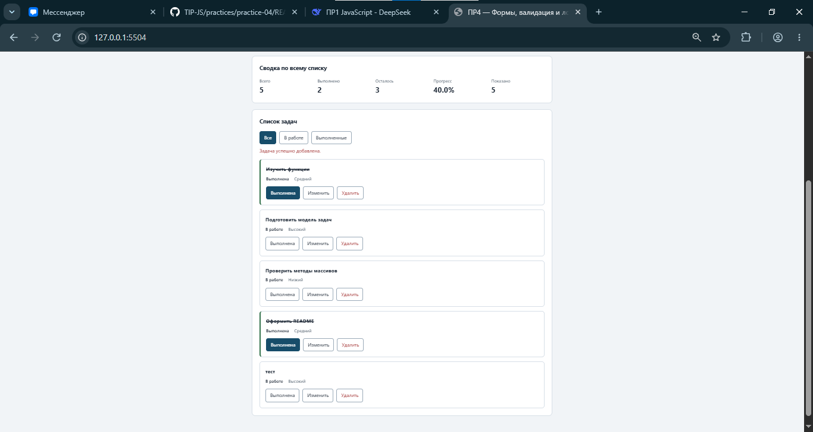
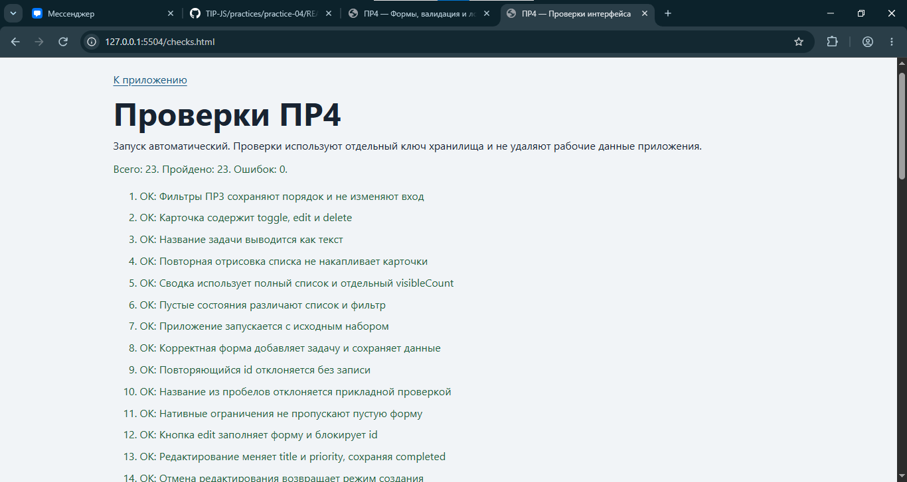
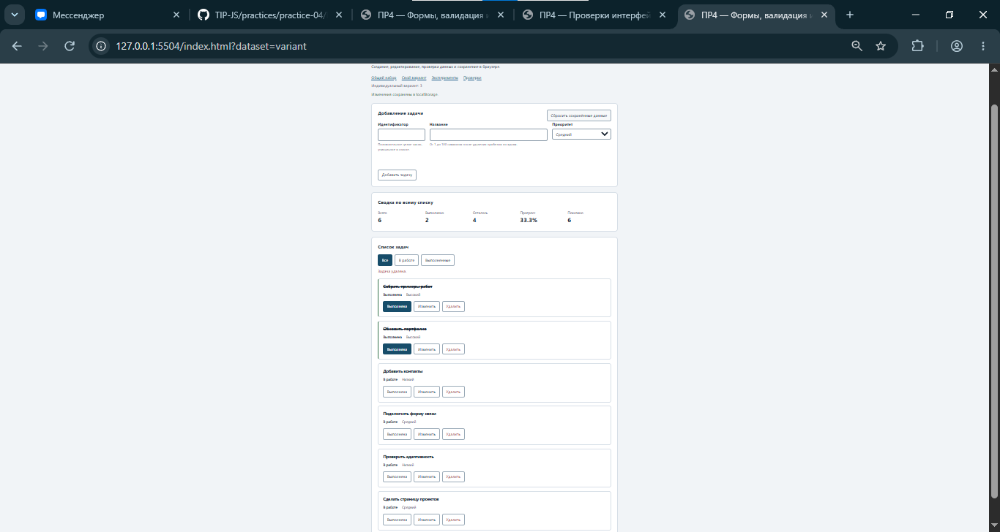

# Практическая работа № 4

**Тема:** Формы, валидация и локальное хранение данных
**Дисциплина:** Технологии индустриального программирования
**Автор:** Барахоев Абдуллах
**Группа:** ЭФБО-14-25
**Вариант:** 3

## 1. Окружение

- ОС: Windows 11
- Node.js: 24.x.x 
- npm: 11.x.x
- Git: 2.x.x
- Браузер: Chrome 130

## 2. Запуск приложения

```bash
cd practice-04
npm start
```

Адреса:
- Общий набор: `http://127.0.0.1:5504/`
- Индивидуальный вариант: `http://127.0.0.1:5504/index.html?dataset=variant`
- Проверки: `http://127.0.0.1:5504/checks.html`

## 3. Задание 1. Эксперименты с формой и JSON

Эксперименты проводились на странице `http://127.0.0.1:5504/examples/forms-storage.html`.

| № | Прогноз до запуска | Фактический результат | Объяснение |
|---|---|---|---|
| 1 | Форма не отправится, браузер покажет ошибку | Браузер показал встроенное сообщение, `submit` не сработал | HTML-атрибут `required` блокирует отправку до вызова JS |
| 2 | Форма отправится, но JS выдаст ошибку | Появилось сообщение об ошибке от `setCustomValidity` | Строка из пробелов не пустая, `required` её пропускает. Нужен `trim()` |
| 3 | Данные придут в консоль | `FormData` вернул строки, `event.defaultPrevented` = true | `FormData.get()` всегда возвращает строку |
| 4 | Данные сохранятся и прочитаются | В `localStorage` лежит строка JSON, при чтении стал объект | Объекты нельзя сохранить напрямую, нужен `JSON.stringify` и `JSON.parse` |
| 5 | Программа упадет с ошибкой | Ошибка поймана через `try/catch`, вывелось сообщение о сбое | `JSON.parse` кидает исключение на битом JSON. Нужен перехват |

## 4. Задание 2. Перенос ПР3

Перенесены 4 файла из `practice-03/src/`: `data.js`, `task-service.js`, `task-selectors.js`, `task-view.js`. В карточку в `task-view.js` добавлена третья кнопка `data-action="edit"`.

## 5. Задание 3. Обновление задачи

В `task-service.js` добавлена функция `updateTask`. Она меняет только `title` и `priority`, используя `createTask` для валидации, и сохраняет `id` и `completed`.

## 6. Задание 4. Чистая валидация формы

В `form-validation.js` реализована функция `validateTaskDraft`. Она проверяет `id` (на уникальность и положительность), `title` (через `trim` и длину 1-100) и `priority` (строго low/medium/high). В режиме редактирования берет ID из `editingId`.

## 7. Задание 5. Модуль локального хранения

В `task-storage.js` реализованы функции `isValidTaskList`, `loadTasks`, `saveTasks` и `removeSavedTasks`. Схема данных оборачивается в объект `{ version: 1, tasks: [...] }`. Ошибки чтения или битый JSON перехватываются через `try/catch` и возвращают исходный набор.

## 8. Задания 6–8. Интеграция и общий сценарий

В `main.js` реализованы:
- Переключение режимов формы: создание и редактирование.
- Обработка `submit` с вызовом `validateTaskDraft`, `addTask` и `updateTask`.
- Делегирование кликов по карточкам (toggle, delete, edit) и фильтрам.
- Кнопка сброса удаляет только ключ `tip-js-practice-04:demo` (или `variant`) и восстанавливает исходные данные.

### Скриншот 1. Сохранение после добавления



*Показано состояние после добавления задачи ID=20 и перезагрузки страницы (F5). Задача сохранилась в localStorage.*

### Скриншот 2. Результаты проверок



*Результат: Всего 23. Пройдено 23. Ошибок 0.*

## 9. Индивидуальный вариант (Вариант 3)

1. Добавлена задача `id = 75` (Приоритет: medium).
2. Отредактирована задача `id = 23` (Название изменено, приоритет high).
3. Удалена задача `id = 37`.
4. Страница перезагружена — изменения сохранились.
5. Общий набор `demo` не изменился (осталось 4 задачи).
6. После сброса вернулись исходные 6 задач варианта.

### Скриншот 3. Индивидуальный вариант



*Итоговое состояние варианта 3: добавлена 75, изменена 23, удалена 37. Прогресс 33.3%.*

## 10. Собственные проверки

1. **Граничный случай формы:** Попытка добавить задачу с названием из 101 символа. Ожидание: ошибка валидации, список не меняется. Факт: ошибка появилась, задача не добавилась.
2. **Восстановление после перезагрузки:** Добавление задачи с ID=99 и обновление страницы (F5). Ожидание: задача на месте, статус «Данные восстановлены». Факт: задача сохранилась.
3. **Повреждение хранилища:** В DevTools в ключ `tip-js-practice-04:demo` записана строка `{broken`. Обновление страницы. Ожидание: программа не падает, показывает предупреждение и загружает исходный набор. Факт: ошибка перехвачена, отобразился fallback.

## 11. Вывод

В ходе работы освоены обработка HTML-форм через `submit` и `FormData`, два уровня валидации (HTML-атрибуты и чистая JS-функция), сериализация данных в JSON и сохранение в `localStorage` с защитой от поврежденных данных. Наиболее важным было понять, что `localStorage` хранит только строки, а `JSON.parse` не гарантирует корректность структуры — требуется полная проверка схемы.